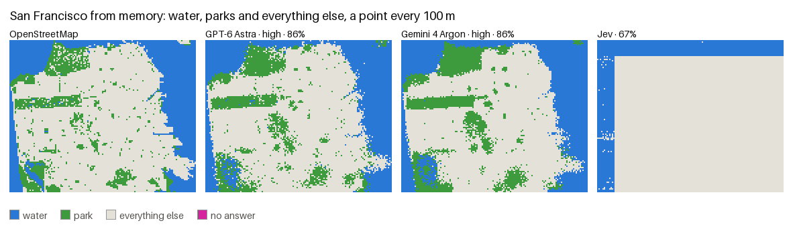
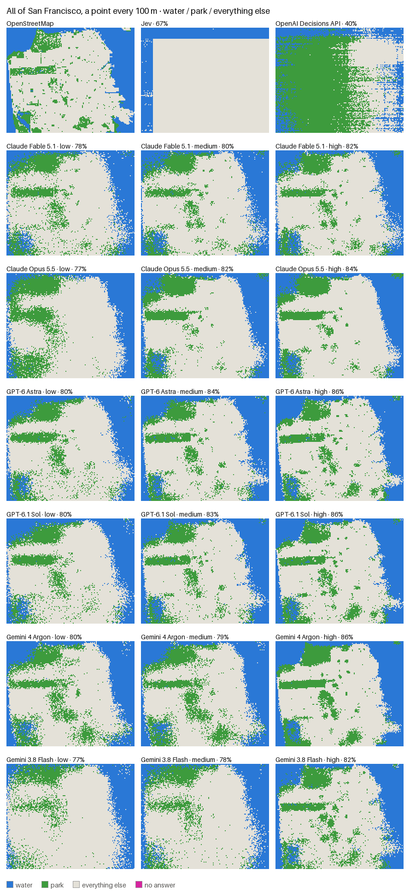
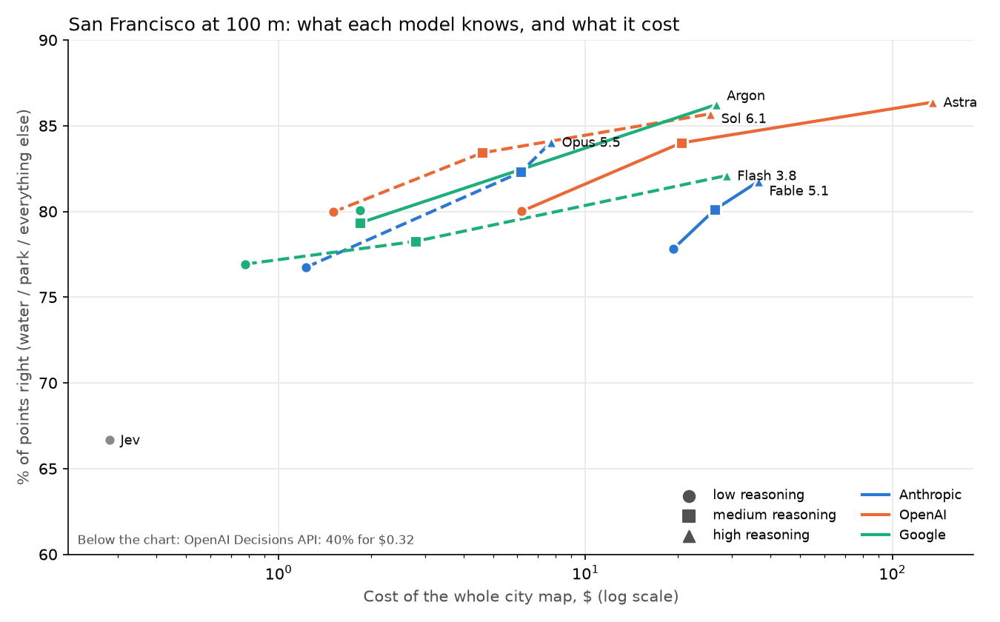
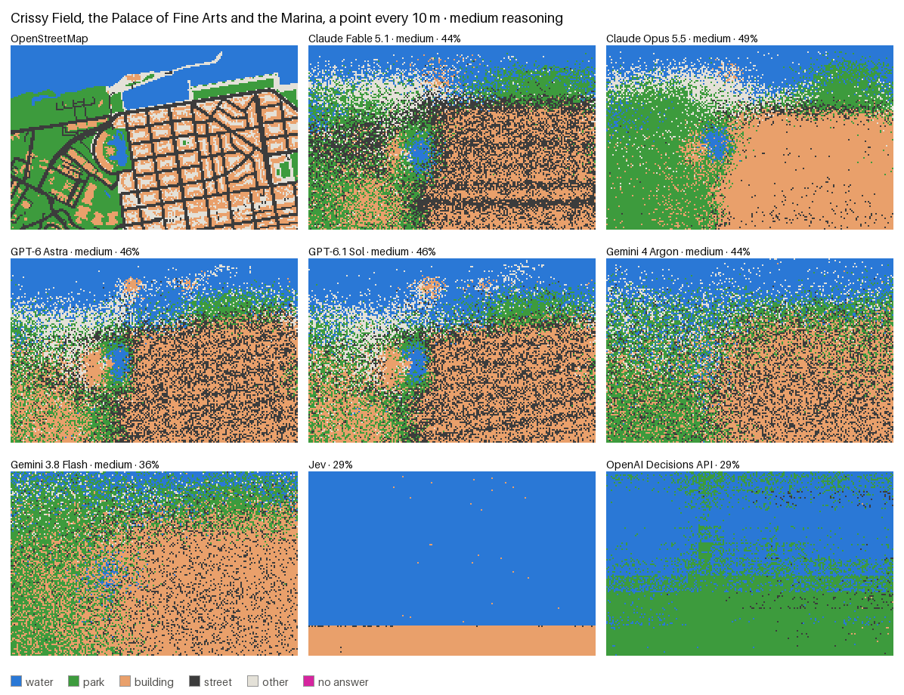
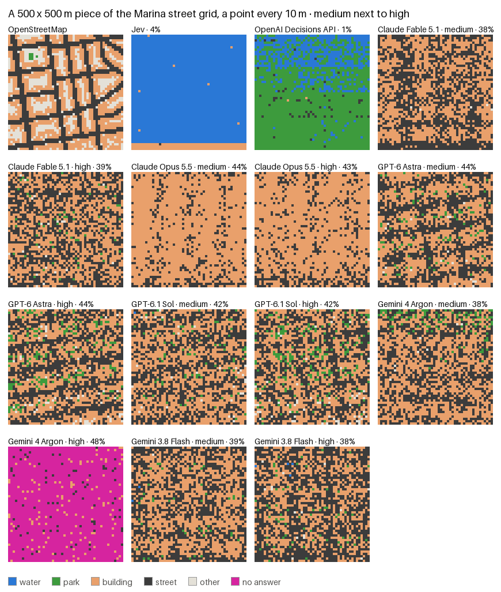
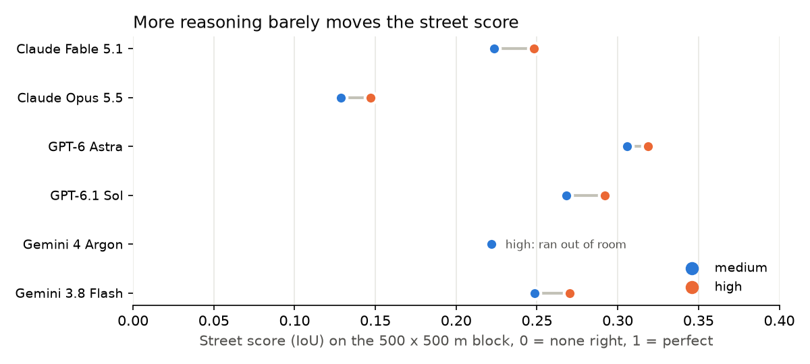

# Can AI draw San Francisco from memory?

In 2023, [Gurnee and Tegmark](https://arxiv.org/abs/2310.02207) showed that you can read the latitude and longitude of places straight out of a language model's activations. So there is a map in there somewhere. We wanted to see it.

We gave six AI models 41,526 points of San Francisco and asked what is at each one: water, a park, a building, a street or something else. They answered from memory, with no maps and no internet, and we checked every answer against OpenStreetMap.



The best models know San Francisco like a tourist with a good memory. They put the coastline, Golden Gate Park and the Presidio in the right place and get the street grid wrong. Paying five times more bought the same score, and thinking harder did not find the streets. Jev, a model from TypeSafe that we asked one point at a time, put the Marina underwater and was only 37% sure of its answers there.

| | |
|---|---|
| **86%** | of points right on the San Francisco map for the best models. Answering "not water, not park" everywhere gets 61% |
| **$26 vs $135** | Gemini 4 Argon, GPT-6.1 Sol and GPT-6 Astra tie for the best city map. Astra costs five times more |
| **0.32** | the best street score on a 500 m block of the Marina, where 1 means every street in the right place. The same number of streets in random places scores 0.23 |
| **23 of 25** | requests Gemini 4 Argon left empty on that block at high reasoning. The joint best model on the city map is the least reliable one |
| **11-12%** | of points changed when we asked two of the models the same questions again. Their scores moved by less than half a point |

The code, every answer and the answer keys are open. Three commands rebuild the scores, costs and figures without an API key ([run it yourself](#run-it-yourself)).

Jump to: [the whole city](#san-francisco-at-100-m) · [the Marina](#the-marina-at-10-m) · [one block, medium against high](#medium-against-high-reasoning-on-one-marina-block) · [what broke](#when-the-models-broke) · [how precise this is](#how-precise-is-this)

## What we asked

Every chat model got the same question, 100 points at a time, in random order:

> You are taking part in a map-knowledge test about San Francisco, California. Answer from your own knowledge only.
>
> Below are 100 locations in San Francisco, in no particular order, as WGS84 latitude, longitude: `1. 37.80241, -122.44853` ...
>
> For each location give one letter for what is at that exact spot: W = water (bay, ocean, lake or pond), P = park, lawn, trees or other green open space, H = inside a building, S = on a street (roadway or sidewalk), O = anything else (parking lot, plaza, beach or empty lot).

We tested two models from each of the big three, at low, medium and high reasoning:

| Anthropic | OpenAI | Google |
|---|---|---|
| Claude Fable 5.1 | GPT-6 Astra | Gemini 4 Argon |
| Claude Opus 5.5 | GPT-6.1 Sol | Gemini 3.8 Flash |

We also asked two things that are not chat models, one point at a time: Jev by TypeSafe, and OpenAI's Decisions API, which runs GPT-6 Luna. Both answer a multiple-choice question and return a probability for each choice, so they seemed a natural fit for "which of these five is it?"

There are three maps:

1. **All of San Francisco, a point every 100 m.** 15,846 points. At this spacing a point lands on a street or a building by chance, so we score it as water, park or everything else.
2. **Crissy Field, the Palace of Fine Arts and the Marina, a point every 10 m.** 23,180 points and all five classes. We slid a box this size over the whole city, and of 236 positions this one has the 4th most even mix of water, parks, buildings and streets. We took it over the top three (Ocean Beach, Lands End and Hunters Point) because it puts Crissy Field, the Palace of Fine Arts and the Marina's grid in one box.
3. **A 500 x 500 m piece of the Marina street grid, a point every 10 m.** 2,500 points at medium and at high reasoning, to see if more thinking finds the streets.

## San Francisco at 100 m



| Model | Reasoning | Right | mIoU | Cost |
|---|---|---|---|---|
| Gemini 4 Argon | high | 86.2% | 0.70 | $26.62 |
| GPT-6 Astra | high | **86.4%** | 0.70 | $135.13 |
| GPT-6.1 Sol | high | 85.7% | 0.69 | $25.52 |
| GPT-6 Astra | medium | 84.0% | 0.66 | $20.50 |
| Claude Opus 5.5 | high | 84.0% | 0.65 | $7.72 |
| GPT-6.1 Sol | medium | 83.4% | 0.65 | $4.61 |
| Gemini 3.8 Flash | high | 82.1% | 0.64 | $28.79 |
| Claude Opus 5.5 | medium | 82.3% | 0.62 | $6.17 |
| Claude Fable 5.1 | high | 81.7% | 0.62 | $36.58 |
| Gemini 4 Argon | low | 80.1% | 0.62 | $1.84 |
| Gemini 4 Argon | medium | 79.3% | 0.61 | $1.85 |
| GPT-6 Astra | low | 80.0% | 0.60 | $6.19 |
| GPT-6.1 Sol | low | 80.0% | 0.60 | $1.51 |
| Claude Fable 5.1 | medium | 80.1% | 0.59 | $26.39 |
| Claude Fable 5.1 | low | 77.8% | 0.56 | $19.29 |
| Claude Opus 5.5 | low | 76.7% | 0.56 | $1.23 |
| Gemini 3.8 Flash | medium | 78.3% | 0.55 | $2.79 |
| Gemini 3.8 Flash | low | 76.9% | 0.52 | $0.78 |
| Jev | - | 66.7% | 0.32 | $0.28 |
| OpenAI Decisions API | - | 40.4% | 0.28 | $0.32 |

*Right* is the share of points with the right answer. *mIoU* is fairer when the classes are uneven: for each class, take the points where the model and the map agree and divide by the points where either of them says that class, then average over water, park and everything else. The table is sorted by mIoU.



Every model draws its best map at high reasoning. Gemini 4 Argon stays flat from low to medium, because it only starts reasoning at high. Claude Fable 5.1 costs the most at low and medium and lands behind the OpenAI models and Gemini 4 Argon on mIoU at every level.

At high reasoning, Gemini 4 Argon, GPT-6.1 Sol and GPT-6 Astra are within a point of each other, which is a tie, and Astra costs five times more than the other two. GPT-6.1 Sol gets 83% at medium for $4.61.

Argon reached the top only after we re-sent the 4 of its 159 requests that came back empty. On denser maps it breaks much more often (see [When the models broke](#when-the-models-broke)).

The good maps all have the coastline, Golden Gate Park, the Presidio and Lake Merced. Small parks are hit and miss: the best park score is 0.45. Jev draws a box, with water around the edge and everything else inside, which still beats answering "everything else" everywhere. The Decisions API calls 53% of the city a park.

## The Marina at 10 m



| Model (medium reasoning) | Right | mIoU | Street score | Cost |
|---|---|---|---|---|
| GPT-6 Astra | 46.3% | **0.30** | 0.20 | $35.62 |
| Claude Opus 5.5 | **48.8%** | 0.29 | 0.04 | $7.99 |
| GPT-6.1 Sol | 46.0% | 0.29 | 0.19 | $7.46 |
| Claude Fable 5.1 | 44.1% | 0.28 | **0.21** | $50.34 |
| Gemini 4 Argon | 44.2% | 0.27 | 0.14 | $2.80 |
| Gemini 3.8 Flash | 36.2% | 0.19 | 0.09 | $2.65 |
| OpenAI Decisions API | 29.3% | 0.11 | 0.01 | $0.46 |
| Jev | 29.2% | 0.09 | 0.00 | $0.41 |

All five classes count here. GPT-6 Astra, GPT-6.1 Sol, Claude Fable 5.1 and Claude Opus 5.5 put the Palace of Fine Arts lagoon in the right place, and Astra and Sol put the Palace building next to it. Fable draws the Marina's long east-west streets as stripes across the whole map.

Claude Opus 5.5 does not believe in streets. It calls 3% of the Marina a street, against 21% in reality, and paints the grid as one big building. That gets it the most points right and the lowest street score of any chat model.

Fable, Astra and Sol score 0.19-0.21 on streets here, against 0.11-0.14 if their own answers were shuffled at random. That looks like knowing which parts of the map are dense grid and which are park.

Jev puts the Marina underwater: 84% of its answers here are water. It was not sure, though. Jev gives a probability for each of the five answers, and the one it picked got 37% on average, against 20% for a blind guess. It was as sure of its wrong answers as of its right ones. The Decisions API's answers were split between water and park, and it was no different: 41% on average, right or wrong.

## Medium against high reasoning on one Marina block

To see whether the models know where single streets run, we took a 500 x 500 m piece of the Marina, 46% buildings and 33% streets, and asked every model at medium and at high reasoning.





| Model | Street score, medium → high | Same answers shuffled (chance) | Right, medium → high | Cost, medium → high |
|---|---|---|---|---|
| GPT-6 Astra | **0.31 → 0.32** | 0.23 | 43.8% → 44.2% | $7.75 → $25.34 |
| GPT-6.1 Sol | **0.27 → 0.29** | 0.23 | 41.9% → 41.6% | $1.47 → $5.05 |
| Gemini 3.8 Flash | 0.25 → 0.27 | 0.24-0.26 | 39.4% → 38.0% | $1.40 → $4.99 |
| Claude Fable 5.1 | 0.22 → 0.25 | 0.24-0.25 | 37.8% → 39.0% | $3.37 → $9.96 |
| Claude Opus 5.5 | 0.13 → 0.15 | 0.12-0.15 | 44.2% → 43.1% | $0.45 → $0.59 |
| Gemini 4 Argon | 0.22 → no answer | 0.23 | 38.3% → 48.5% on the 8% of points it answered | $0.34 → $16.19 |

High reasoning adds 0.01-0.03 to the street score and costs up to 3.6 times as much (Gemini 4 Argon aside: 48 times as much, for answers on 8% of the points). No model draws the grid at either level. The chance column shows what each model would score if we shuffled its own answers around the block, keeping how often it says "street". Only GPT-6 Astra and GPT-6.1 Sol beat that, by 0.04-0.09, which is a thin margin on 25 requests. Claude Fable 5.1, Claude Opus 5.5 and both Geminis score about what they would by putting the same number of streets in random places.

## When the models broke

| What went wrong | Where | How often | What we did |
|---|---|---|---|
| Gemini 4 Argon high ran out of output (32,768 tokens) | city map | 4 of 159 requests | asked again, and all 4 answered on the second try |
| Gemini 4 Argon high ran out of output | Marina block | 23 of 25 requests, then 24 retries in a row | stopped retrying, left a hole in the map |
| OpenAI's Batch API stopped making progress | city map and Marina | 5 of 8 batches, for about an hour | cancelled them, kept what they had finished, sent the 142 missing requests through the regular API |
| GPT-6.1 Sol high requests never came back | city map | 11 of those 142 | sent again in background mode, and all 11 answered |
| Anthropic, Gemini 3.8 Flash, Gemini 4 Argon low and medium, Jev, Decisions API | everywhere | never | - |

Gemini 4 Argon thinks itself out of room. At high reasoning it thinks for about 15,000 tokens per request on the city map. On the dense Marina block it thinks for about 30,000, even when we send it only 10 points. Its output limit is 32,768 tokens, thinking included, so 10-point requests just fit. Redoing the block that way would have cost about $75, so we left the hole.

GPT-6.1 Sol at high can think for up to half an hour per request. After OpenAI's Batch API stalled, we sent the rest through the regular API, and 11 requests outlasted our 30-minute connection limit. OpenAI's background mode, which runs the request on their side and lets you check back later, finished all 11.

In early tests, models asked for 100 letters in a row sometimes wrote 90 or 101. So every answer is numbered ("17:H"), and a missing or extra letter cannot shift the rest.

Apart from Gemini 4 Argon high on the block, every run answered 100% of its points.

## How precise is this?

We ran GPT-6.1 Sol medium and Gemini 4 Argon low on the city map a second time. 12% and 11% of points changed between water, park and everything else (29% and 25% with all five classes), but the scores moved by less than half a point: 83.4% to 83.7% and 80.1% to 79.7%. So both scores held while single points flipped.

We also asked Jev and the Decisions API about every point a second time, to keep their probabilities. The Decisions API gave the same answers both times. Jev changed 9% of its answers on the city map and under 1% elsewhere, and its scores held.

The 95% ranges in [`results/summary.json`](results/summary.json) come from resampling the requests. They are about ±0.5-0.8 points on the city map, so treat models within a point of each other as tied. On the small block they are about ±3 points.

OpenStreetMap is the answer key, so its mistakes count against the models. A point counts as a street if it is within 5-12 m of a street centreline, depending on the type of road. Freeways and footpaths do not count as streets, and private yards, parking lots and plazas land in "other".

Different wording, points in order instead of shuffled, or fewer points per request would change the numbers. Before this setup we asked for whole drawings of each block and for small grids of points. The drawings had seams where blocks met, and the grids came back with whole rows of the same letter, so we switched to shuffled points. We did not tune the setup on the scores.

## How we did it

- **Points.** A grid over each map, shuffled once with a fixed seed and cut into requests of 100 points. Jev and the Decisions API answer one point per request.
- **Asking.** Anthropic and OpenAI through their Batch APIs at half price, Gemini through the regular API. One try per request, except where the table above says otherwise: we asked empty Gemini 4 Argon high answers again (on the block we stopped after 24 retries in a row failed), and OpenAI requests a stalled batch never returned went through the regular API.
- **Answer key.** OpenStreetMap, downloaded on 18 October 2026. A point is water if it is in the sea, a lake or a pond; else a building if it is inside a building footprint; else a street if it is close to a street centreline; else a park; else other.
- **Scoring.** The share of points right, and mean IoU over the classes. A point with no answer stays out of "right" but lowers mIoU.

## Run it yourself

```bash
uv sync
uv run python -m sfmap download      # our answers and answer keys, into data/
uv run python -m sfmap score         # results/summary.json
uv run python -m sfmap figures       # figures/
uv run pytest                        # tests
```

To ask the models yourself, set `ANTHROPIC_API_KEY`, `OPENAI_API_KEY`, `GEMINI_API_KEY` and `TYPESAFE_API_KEY`, then:

```bash
uv run python -m sfmap reference     # download OpenStreetMap, build the answer keys
uv run python -m sfmap run sf100     # or marina10, block10
uv run python -m sfmap collect       # when the batches finish
uv run python -m sfmap retry block10 argon high          # re-send Gemini requests that came back empty
uv run python -m sfmap background sf100 sol high         # OpenAI requests a stalled batch never returned
uv run python -m sfmap background sf100 sol medium --rerun   # a whole second run
uv run python -m sfmap references sf100 --rerun          # Jev and the Decisions API again, with probabilities
```

## Who we are

We are [VOYGR](https://voygr.tech). We build APIs that tell AI agents which places exist, whether they are open and what they offer. This started as a quick question and got out of hand.

Code under the MIT licence. Map data © [OpenStreetMap](https://www.openstreetmap.org/copyright) contributors, ODbL.
